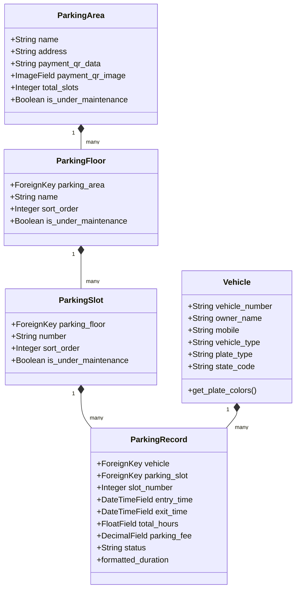

# PARKSAFE — Codebase Architecture & Explanation

This document explains the codebase, data models, views, templates, and validation flows for the **PARKSAFE** parking management system.

---

## 1. Project Directory Structure

```
ParkingManagement/
│
├── manage.py                   # Django CLI entrypoint
├── requirements.txt            # Project dependencies (Django, Pillow, etc.)
│
├── parking_system/             # Project Configuration
│   ├── settings.py             # Database settings, Static/Media roots
│   └── urls.py                 # Core app URL routing (includes parking.urls)
│
└── parking/                    # Core Application
    ├── models.py               # Database schemas (Vehicle, ParkingArea, etc.)
    ├── views.py                # Business logic (Dashboard, Check-in, Exits, Management)
    ├── forms.py                # Form input validations (Check-in, Area creation)
    ├── urls.py                 # App routing paths (History, Receipt, Login/Logout)
    ├── static/
    │   └── css/style.css       # Custom styles
    └── templates/parking/      # Front-end HTML templates
        ├── base.html           # Main boilerplate & navigation layout
        ├── dashboard.html      # Parking layout status & live metrics
        ├── vehicle_entry.html  # Vehicle entry form & slot map
        ├── vehicle_exit.html   # Checkout forms
        ├── history.html        # Permanent logs with deletion modal
        ├── receipt.html        # Payment summaries with custom QR image support
        └── parking_management.html # Parking structures (Areas, Floors, Slots) management
```

---

## 2. Core Database Schema (`parking/models.py`)

The application defines five relational models to track spaces and vehicle entries:



### Models Detailed:

* **`Vehicle`**: Represents vehicles checked into the system. Captures category (Private/Commercial), registration numbers, and owner contact details.
* **`ParkingArea`**: A top-level parking location (e.g., "Main Mall Parking"). It holds custom QR codes (via string links or uploaded images).
* **`ParkingFloor`**: Tracks floors under each area.
* **`ParkingSlot`**: The physical slot/bay where vehicles park.
* **`ParkingRecord`**: Tracks a vehicle's check-in/check-out lifecycle, calculating durations and computing custom rates. Includes the `formatted_duration` property.

---

## 3. Data Flows & Logic

### Check-in Flow (`views.py:vehicle_entry` & `forms.py:VehicleEntryForm`)
1. User enters registration details.
2. If **BH Series** is checked, it verifies registration starts with `BH`. Otherwise, checks if the plate starts with the selected state code.
3. Live validation in the browser triggers immediate errors if formatting does not match.
4. Checks database if slot is occupied or under maintenance. Saves the transaction.

### Check-out & Fee Calculation Flow (`views.py:vehicle_exit`)
1. User enters a license plate.
2. System computes duration in hours.
3. Rates are applied according to vehicle type:
   * **Bike/Motorcycle**: ₹20 1st hr, ₹10/hr after.
   * **Car/Jeep/Van**: ₹50 1st hr, ₹20/hr after.
   * **Auto-rickshaw**: ₹30 1st hr, ₹15/hr after.
   * **Truck/Lorry/Tempo**: ₹100 1st hr, ₹50/hr after.
   * **Bus**: ₹120 1st hr, ₹60/hr after.
4. An invoice receipt is generated containing the fee and the payment QR code.

### Secure History Deletion Flow (`views.py:delete_record`)
1. When deleting a record or clearing history, a JavaScript interceptor blocks the form submission.
2. It displays a sleek authentication modal requesting staff credentials.
3. Submitted credentials are validated via Django's backend `authenticate()` system.
4. Deletion only takes place if credentials match a staff member.

### Advance Booking Flow
1. **Operator Setup (`views.py:booking_form_settings`)**:
   - Operator selects visible fields, required fields, and custom questions.
   - Sets advance booking window rules (lead notice hours, maximum advance days) and terms.
   - Publishes the permanent public form URL and entrance QR code.
2. **Customer Submission (`views.py:public_advance_booking`)**:
   - Customer opens the public form, enters vehicle registration (with live preview) and details.
   - System validates fields and creates an `AdvanceBooking` with a unique reference (`BK-XXXX-YYYY`) and `Pending` status.
   - Customer receives confirmation screen with "Awaiting operator confirmation".
3. **Operator Allocation (`views.py:booking_requests`)**:
   - Operator reviews pending requests in "Booking Requests" dashboard.
   - Checks bay availability and assigns an available slot, or rejects with an explanatory reason.
4. **Customer Status Tracking (`views.py:public_booking_status`)**:
   - Customer enters booking reference and mobile number.
   - Views real-time status: Pending, Confirmed (showing Area, Floor, Bay, Time), Rejected, or Checked In.
5. **Arrival Check-In (`views.py:vehicle_entry` / `views.py:booking_request_action`)**:
   - Gate operator looks up reference or vehicle plate with the fast-check-in search bar.
   - Automatically populates vehicle details and assigns the reserved bay.
   - On check-in, booking status transitions to `Checked In` and creates the active `ParkingRecord`.
   - Vehicle continues through standard checkout and receipt flow.

